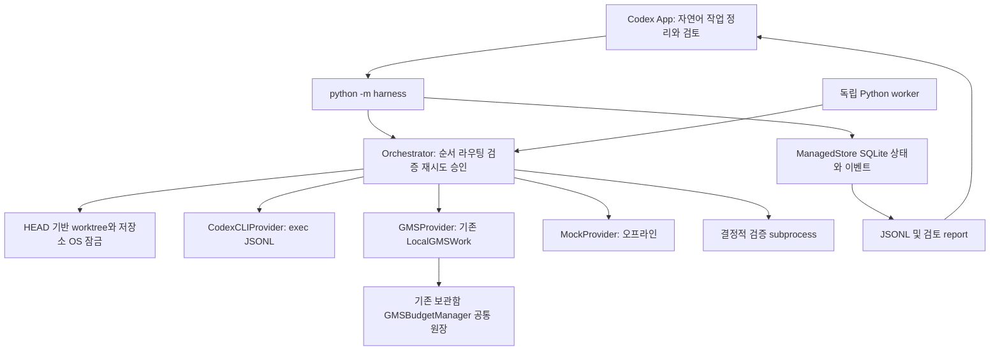

# CLI-First 하네스 구조와 재사용

| 구성요소 | 구현 / 재사용 |
| --- | --- |
| Task/State/Approval/Event | managed.py; SQLite BEGIN IMMEDIATE, 상태와 이벤트 원자 기록 |
| Planner/Context | App이 명시 scope/AC/tasks를 작성; planning.py가 의존성/우선순위 정렬, validate/pack_context가 최소 문맥·검증 조건 확인 |
| Scheduler/Retry/Router | orchestrator.py; 우선순위·의존성·전체/시도 제한·중단 요청·quota 분류 |
| Execution/Validation | execution.py 공통 결과·취소 가능 프로세스·Codex/GMS/Mock, orchestrator의 결정적 검사 |
| Isolation | isolation.py detached worktree·PID 확인·OS 잠금·변경 파일 SHA256·HEAD 고정 |
| Budget | Codex usage는 관측값만 보존; GMS 기존 예산 경로 재사용; Mock 실제 과금 없음 |
| Management | managed_cli.py 및 루트 harness shim; App 전용 API 가정 없음 |
| 기존 native 하네스 | state.py/contracts.py/gateway.py/cli.py 그대로 보존 |

기존 v1 Store의 역할·상태·Task 필드를 확장하지 않고 별도 DB를 택했다. 공통 contracts의 경로·비밀·해시와
기존 GMS prepare_work/LocalGMSWork를 재사용한다. 새 원장으로 GMS 예산을 이중 계산하지 않는다.
작업별 별도 LLM Planner/Reviewer 호출은 강제하지 않는다. 자연어 판단은 App/담당자 검토이며
모든 명시 AC에 검증 명령이 필요하다. 별도 지능형 자동 작업 분해·분산 worker·웹 dashboard는 후속 확장이다.

첨부의 과거 Plan/Prompt/reuse manifest 파일명은 현재 저장소 검색에서 없었다. 기존
[출처 조사](origins.md), [하네스 Plan](../plans/harness-integration.md),
[Master 절차](master-workflow.md)를 대응 자료로 읽었다. 출처 ZIP 소스를 새로 복사하지 않았다.
실행 중 미커밋 변경이 많아 root 작업을 다른 브랜치로 옮기거나 commit하지 않았다.
자동 worker는 그 변경과 독립적인 HEAD 기준 worktree를 사용한다.

주요 트레이드오프는 직렬 managed 실행으로 충돌을 줄이는 대신 병렬 처리량이 낮고,
GMS의 검증된 능력을 초안으로 한정해 자동 코드 수정 전환이 수동 검토 단계를 필요로 한다는 점이다.
